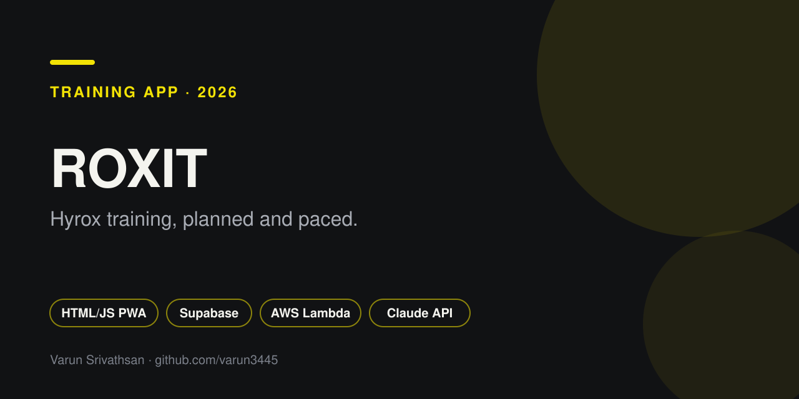

# Roxit

A phone first Hyrox training app: an 8 week plan, guided workouts, and a race forecast, built for the Hyrox London Men's Open.

   

## What it does

- Builds an 8 week plan and walks you through each session with guided workouts.
- Forecasts race performance from your training data.
- Ships an optional AI coach read through a serverless function that calls the Anthropic API.
- Lists official Hyrox events for the 2026/27 season (`races.js`).
- Installs to the home screen as a PWA, with light and dark themes.

## Design notes

- Phone first layout in bold condensed headings over a graphite ground.
- Race yellow is reserved for the countdown and primary actions.
- Each session type has its own colour, so the plan reads at a glance.

## Stack

| Layer | Choice |
| --- | --- |
| Front end | Single page HTML, CSS and vanilla JavaScript, no build step |
| Auth and data | Supabase (`supabase/schema.sql`), or an AWS path using Cognito, API Gateway (JWT authorizer), Lambda and DynamoDB (`aws/template.yaml`) |
| AI | Anthropic API via `api/coach.js` |
| Hosting | Vercel |

## Run it

1. Run `supabase/schema.sql` in your Supabase project, then set the URL and publishable key in `config.js`.
2. Add your Vercel URL under Auth, URL Configuration.
3. Optional: set `ANTHROPIC_API_KEY` in Vercel environment variables to enable the coach read.
4. Import the repo in Vercel. There is no build step.

For the AWS backend, follow `aws/README.md`.

## Author

Designed and built by [Varun Srivathsan](https://varunsrivathsan.com).
